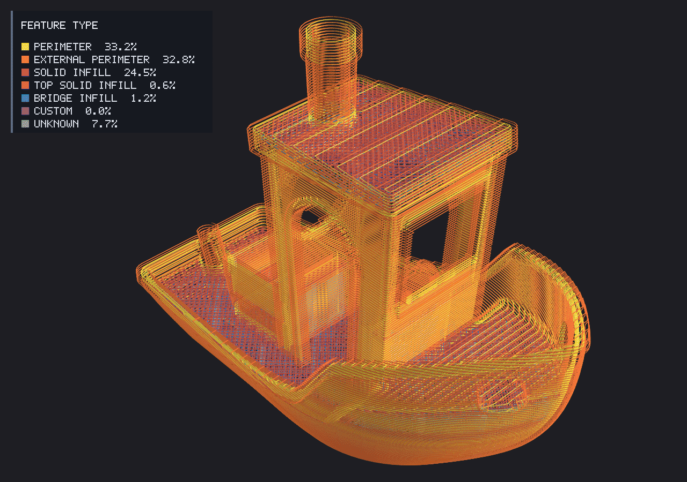

# gcv

3D G-code toolpath viewer with interactive GUI and CLI PNG export. Supports `.gcode` and `.bgcode` files.

[](https://github.com/hyiger/gcode-lib/blob/48343a78659424cf2b14e7299ca90568306c4ede/tests/3DBenchy_0.6n_0.32mm_FLEX_COREONE_32m.gcode)

## Features

- Interactive 3D visualization with layer-by-layer slider
- 6 color modes: feature type, height, speed, fan speed, temperature, volumetric flow
- Static PNG export for batch/CI workflows
- 4 camera presets (isometric, top, front, side) + custom azimuth/elevation
- PrusaSlicer TYPE comment parsing for feature-type coloring
- Auto-detected bed dimensions with grid overlay

## Installation

Download a Linux binary from the [rolling release](https://github.com/apkd/gcv/releases/tag/release), or install from source:

```bash
cargo install --path . --locked
```

With Nix, run `nix profile add .` from the checkout.

## Usage

### Interactive GUI

```bash
gcv model.gcode
```

**Keyboard shortcuts:**

| Key | Action |
|-----|--------|
| `1` | Isometric camera |
| `2` | Top-down camera |
| `3` | Front camera |
| `4` | Side camera |
| `T` | Toggle travel moves |
| `V` | Cycle color mode |
| `S` | Save screenshot |

### CLI Export

```bash
# Basic export
gcv model.gcode --export output.png

# Custom options
gcv model.gcode -e output.png \
  --camera front \
  --layer 50 \
  --resolution 2560x1440 \
  --color-mode height \
  --show-travel \
  --no-bed

# Custom camera angle
gcv model.gcode -e output.png \
  --camera-azimuth 45 --camera-elevation 30
```

### CLI Options

| Option | Default | Description |
|--------|---------|-------------|
| `--export`, `-e` | — | Export PNG and exit |
| `--camera`, `-c` | `isometric` | Camera preset: `isometric`, `top`, `front`, `side` |
| `--camera-azimuth` | — | Custom azimuth (degrees) |
| `--camera-elevation` | — | Custom elevation (degrees) |
| `--layer`, `-l` | all | Maximum layer to display |
| `--resolution`, `-r` | `1920x1080` | Export resolution (WxH) |
| `--show-travel` | off | Show travel moves |
| `--no-bed` | off | Hide print bed |
| `--color-mode` | `feature` | `feature`, `height`, `speed`, `fan`, `temperature`, `flow` |
| `--min-layer` | 0 | Minimum layer to display |
| `--scale`, `-s` | 1 | Scale viewport and PNG resolution (e.g. `0.5` for half width and height) |
| `--no-legend` | off | Hide the legend |
| `--orthographic` | off | Use an orthographic camera |
| `--stats` | off | Print toolpath statistics as JSON |
| `--strict` | off | Reject unsupported or approximate commands |

## Architecture

```
G-code file
    |
    v
parser.rs / bgcode.rs  --> parsed toolpaths
    |
    v
    +--> GPU viewport  --> interactive viewer
    |
    +--> CPU renderer  --> PNG export
```

## Testing

```bash
cargo test --locked --all-features
cargo test --locked --no-default-features
```

## Project Structure

```
src/
  types.rs          # segments, layers, toolpath data
  parser.rs         # G-code parsing
  bgcode.rs         # binary G-code decoding
  geometry.rs       # strokes and arcs
  colors.rs         # color palettes, gradients, legend labels
  camera.rs         # camera preset calculations
  renderer.rs       # toolpath and bed rendering
  gui.rs            # interactive viewer
  cli.rs            # command-line options and PNG export
tests/              # unit and integration tests
```
